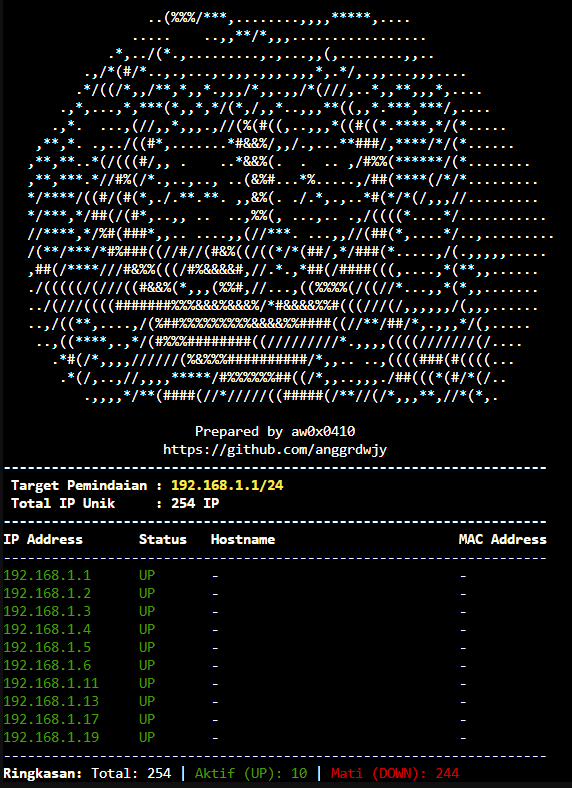

## Information

This tools for multiple IPv4 scanning

<p align="center">

</p>

#### Installing Tools
```
root@server1:~# git clone https://github.com/anggrdwjy/multiple-ipscan.git
root@server1:~# cd multiple-ipscan
root@server1:~multiple-ipscan# chmod -R 777 *
root@server1:~multiple-ipscan# ./ipscan_v3.sh
```

#### Running Tools

* Running Tools (Default IPv4, 192.168.1.1)
```
root@server1:~# ./ipscan_v3.sh
```
* Scanning Single IPv4
```
root@labstack:~# ./ipscan_v3.sh 192.168.1.1/24 1 up
```
* Scanning Multiple IPv4
```
root@labstack:~# ./ipscan_v3.sh 192.168.1.1/24,10.14.4.1/28,172.23.74.100/24 1 up
```

## Support

* [:octocat: Follow me on GitHub](https://github.com/anggrdwjy)
* [🔔 Subscribe me on Youtube](https://www.youtube.com/@anggarda.wijaya)
