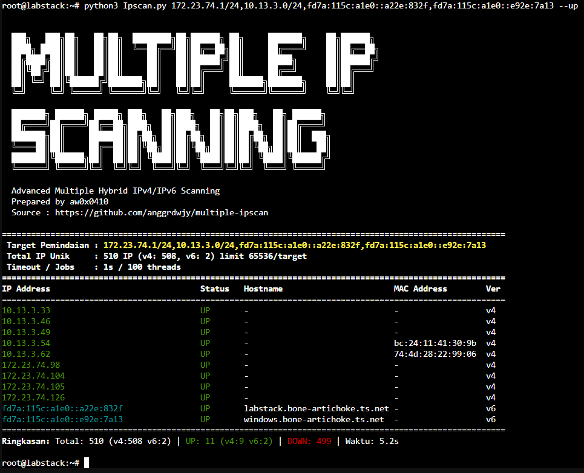

## Information

<p align="left">

</p>

#### Quick Start
```
chmod +x multiple_ipscan.py

# Single network
python3 multiple_ipscan.py 192.168.1.0/24

# Mixed IPv4 + IPv6 + export
python3 multiple_ipscan.py 192.168.1.1,fd00::1,10.0.0.1-10.0.0.20 -t 1 --jobs 100 --csv result.csv --json result.json

# Only hosts that are UP, no color, no banner (for cron / scripts)
python3 multiple_ipscan.py fd00::/120 --up-only --no-color --no-banner --csv up.csv --json up.json
```

#### Usage
```
python3 multiple_ipscan.py <target> [options]
Positional:
  target                  Target IP/CIDR/Range, comma-separated for multiple.
                          Can mix v4 & v6. Example: 192.168.1.0/24,fd00::/120
Options:
  -t, --timeout SEC       Ping timeout in seconds (default: 1)
  -m, --mode MODE         Display mode: all (UP & DOWN) or up_only (default: all)
  --max-ips N             Max IPs per target (anti /64 bomb, default: 65536)
  --jobs N                Number of concurrent threads (default: 100, bash version is 80)
  --csv FILE              Export results to CSV
  --json FILE             Export results to JSON
  --up-only               Shortcut for --mode up_only
  --no-color              Disable colors
  --no-banner             Hide ASCII banner
  -h, --help              Show help
```

#### Examples
```
# CIDR IPv4
python3 multiple_ipscan.py 192.168.1.0/24

# CIDR IPv6
python3 multiple_ipscan.py fd00::/120 --csv result.csv --json result.json

# Range
python3 multiple_ipscan.py 192.168.1.10-192.168.1.50
python3 multiple_ipscan.py 2001:db8::1-2001:db8::ff

# Multiple mixed targets
python3 multiple_ipscan.py 192.168.1.1,fd00::1,10.0.0.1-10.0.0.20,2001:db8::1-2001:db8::ff -t 1 --jobs 100

# Public DNS check
python3 multiple_ipscan.py 8.8.8.8,1.1.1.1,2001:4860:4860::8888 --csv google_dns.csv --json google_dns.json

# Link-local (interface is required)
python3 multiple_ipscan.py fe80::1%eth0

# Limit large prefix
python3 multiple_ipscan.py 10.0.0.0/16 --max-ips 1000 --jobs 200
```

## Support

* [:octocat: Follow me on GitHub](https://github.com/anggrdwjy)
* [🔔 Subscribe me on Youtube](https://www.youtube.com/@anggarda.wijaya)
